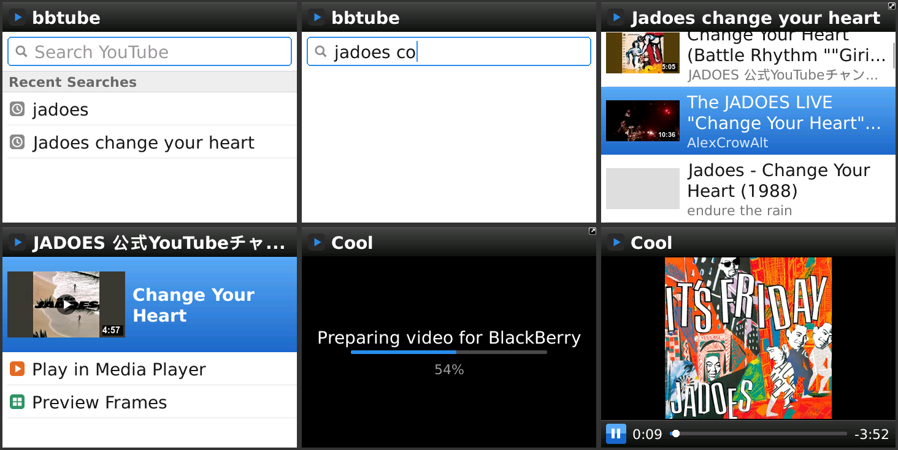
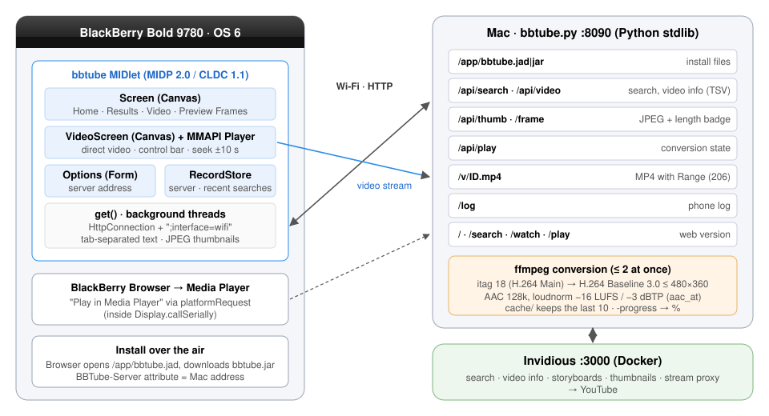

<p align="center"></p>

<h1 align="center">bbtube</h1>

**A native YouTube app for the BlackBerry Bold 9780 (BlackBerry OS 6)**, backed by a small server on a Mac that runs on top of a local [Invidious](https://github.com/iv-org/invidious) instance.

The phone app is a Java ME (MIDP 2.0 / CLDC 1.1) MIDlet. It draws its own screens to match the BlackBerry OS 6 look. The Mac side searches through Invidious, makes thumbnails and preview frames, and converts each video to a format the 9780 can decode. It also serves the app for installation over Wi‑Fi.

Current version: **1.3.4**



*Screenshots taken from the phone over USB with Barry's `bjavaloader screenshot` (480×360, native resolution).*

---

## Features

### On the phone
- **Native OS 6 look.** Every screen is drawn on a Canvas: dark gradient title bar with the app icon, white list rows, grey section bands, the blue gradient selection bar and a scroll indicator, all in the style of BlackBerry's own apps.
- **Type to search.** Start typing on the home screen and the text goes straight into the search box. It has a blinking caret and a placeholder. Enter runs the search, and Delete removes characters.
- **Recent searches.** The last 8 searches are kept on the phone (RecordStore). Typing filters them, and the BlackBerry menu's *Delete* removes one.
- **Search results with thumbnails.** Each result shows a 120×67 thumbnail with the video length burned in (red **LIVE** for live streams), the title and the channel. *More Results* loads the next page.
- **Video page.** A large 192×108 thumbnail with a play overlay, plus the title and channel. It also has **Play in Media Player** and **Preview Frames**.
- **Preview Frames.** A grid of frames from across the video, with timestamps, taken from YouTube storyboards.
- **In-app player** in the same style:
  - The video sits between the title bar and a Media Player‑style control bar: a blue play/pause button, elapsed time, a track with a knob, and time remaining.
  - **Trackpad left/right** skips back or forward 10 s. Several presses add up into one jump.
  - **Trackpad click or Space** pauses and resumes.
  - Header status shows *Buffering…*, *Paused* or *Finished*.
  - While the Mac converts the video, a **"Preparing video for BlackBerry" progress bar** shows how far along it is. While connecting, a spinner shows instead.
- **Play in Media Player.** Hands the video to BlackBerry's built-in Media Player through the browser, for full-screen playback with the system's controls.
- **Trackpad and keyboard navigation everywhere.** Trackpad up/down moves the selection, click or Enter opens, and the Back key goes back one screen.
- **Options.** Set the Mac's address and port. The address the app was installed from is filled in automatically.
- **Wi‑Fi only, no BIS needed.** Every connection uses `;interface=wifi`, and the app works out which connection type the phone accepts.
- **On-device error reporting.** Errors and key presses are sent to the Mac's log, so problems can be fixed without a debugger.

### On the Mac (`bbtube.py`)
- **Installs over the air.** It serves `bbtube.jad`/`bbtube.jar` and writes the server address into the descriptor.
- **Video conversion for the 9780.** It converts YouTube's 360p MP4 to H.264 **Baseline 3.0** at up to 480×360, with AAC‑LC audio levelled to −16 LUFS. The last 10 conversions are cached, and progress is reported to the phone. Conversion starts as soon as a video page is opened.
- **Seekable streaming** with HTTP Range (206) support.
- **Thumbnails and frames** are resized and re-encoded as JPEG, with length badges drawn by ImageMagick.
- **A no‑JavaScript web version** at `/` for the BlackBerry Browser (and anything else).
- **Standard library only.** Python with no pip packages. ffmpeg and ImageMagick are the only external tools.

---

## Architecture



- **Phone:** one MIDlet (`src/BBTube.java`). Hand-drawn Canvas screens, an MMAPI player with direct video, RecordStore for settings and recent searches. All network calls run on background threads over `;interface=wifi`.
- **Mac:** `bbtube.py`, a standard-library Python server. It turns Invidious JSON into tab-separated text the phone parses cheaply, and converts each video once to H.264 Baseline that the 9780 can decode. It streams the result with HTTP Range so the player can seek.
- **Invidious:** a local instance (Docker) that does the talking to YouTube.
- **Two ways to play:** the in-app player streams `/v/ID.mp4` directly. *Play in Media Player* opens the phone's browser on `/play`, which hands the same file to the system Media Player.

Details are in [docs/ARCHITECTURE.md](docs/ARCHITECTURE.md) and [docs/API.md](docs/API.md).

---

## Quick start

```bash
# 1. Invidious running on the Mac at http://localhost:3000 (see docs/HOWTO.md)
# 2. Start bbtube
python3 ~/bbtube/bbtube.py
```

On the phone, open the BlackBerry Browser (Wi‑Fi on) and go to:

```
http://<mac-lan-ip>:8090/app/bbtube.jad
```

Tick **Set Application Permissions**, choose **Download**, then open **bbtube** from the Downloads folder.

To build the app yourself:

```bash
~/bbtube/build.sh
```

Full instructions are in [docs/HOWTO.md](docs/HOWTO.md).

---

## Documentation

| Document | What's in it |
|---|---|
| [docs/HOWTO.md](docs/HOWTO.md) | Setup, install, build, update, using the app, debugging over USB, troubleshooting |
| [docs/ARCHITECTURE.md](docs/ARCHITECTURE.md) | Technical implementation: toolchain, the MIDlet's structure, Canvas UI, player, server, conversion pipeline |
| [docs/API.md](docs/API.md) | The HTTP API between the phone and the Mac |
| [docs/CHALLENGES.md](docs/CHALLENGES.md) | The problems hit along the way, how each was solved, and lessons learned |
| [docs/SCREENSHOTS.md](docs/SCREENSHOTS.md) | Every screen, plus how the UI changed between versions |
| [docs/REFERENCES.md](docs/REFERENCES.md) | Specifications, tools and sources cited |
| [CHANGELOG.md](CHANGELOG.md) | Version history |

---

## Project layout

```
bbtube/
├── bbtube.py            Mac server: install files, phone API, conversion, web version
├── build.sh             Builds and preverifies app/bbtube.jar, then runs the tests
├── test_bbtube.py       Server helper tests
├── icon.png             App icon (home screen)
├── src/
│   ├── BBTube.java      The whole MIDlet (single file, Java 1.3 syntax)
│   ├── TestBBTube.java  Tests for the MIDlet's static helpers (run on the desktop JVM)
│   └── manifest.txt     MIDlet manifest (name, version, profile)
├── res/                 In-app icons (logo, search, recent, more, media, preview, play overlay)
├── tools/               Build toolchain jars (ECJ, MicroEmulator API stubs, ProGuard), fetched by build.sh
├── app/bbtube.jar       Build output, served to the phone (not committed)
├── cache/               Converted videos (last 10)
├── bbtube.log           Server log, including messages sent from the phone
└── docs/                Documentation and screenshots
```

## Requirements

| Side | Needs |
|---|---|
| Phone | BlackBerry with OS 6 (built and tested on a Bold 9780), with Wi‑Fi on the same LAN as the Mac |
| Mac | Python 3.8+ (tested on 3.14), ffmpeg with `libx264` (tested on 8.1), ImageMagick 7 (for length badges, optional), Java (for building), a running Invidious on port 3000 |

## Status and limits

- Tested on one device: a Bold 9780 on BlackBerry OS 6.
- The app is unsigned. The phone asks for permission on first network use, unless *Set Application Permissions* is ticked at install time.
- Videos must have YouTube's 360p MP4 stream (itag 18) for conversion.
- The first play of a video waits for the conversion to finish. How long depends on the video's length and the Mac. Opening the video page starts it early, so it's often done by the time Play is pressed.
- The Mac and phone must be on the same network. There is no authentication, so don't expose port 8090 to the internet.

## Credits

bbtube stands on [Invidious](https://github.com/iv-org/invidious), [FFmpeg](https://ffmpeg.org), [ImageMagick](https://imagemagick.org), [Eclipse ECJ](https://projects.eclipse.org/projects/eclipse.jdt), [MicroEmulator](https://github.com/barteo/microemu)'s API jars, [ProGuard](https://github.com/Guardsquare/proguard) and [Barry](https://sourceforge.net/projects/barry/). See [docs/REFERENCES.md](docs/REFERENCES.md).

YouTube is a trademark of Google LLC. BlackBerry is a trademark of BlackBerry Limited. This is a personal, non-commercial project and is not affiliated with either.
