# Screenshots

All screenshots were taken on a **BlackBerry Bold 9780 (OS 6)** over USB with Barry (`bjavaloader screenshot`), at the screen's native 480×360.

## Home and search

| Home | Typing a search | Searching |
|---|---|---|
| 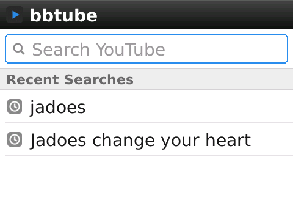 | 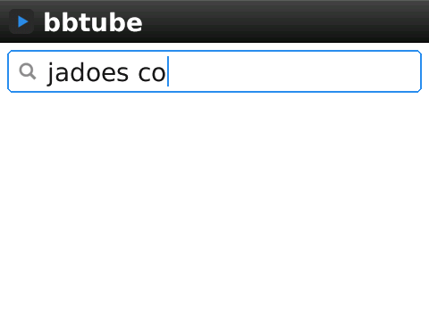 | 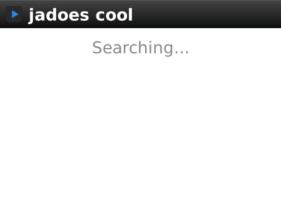 |
| Search box, then *Recent Searches*. Start typing to search. | Text goes straight into the box, with a blinking blue caret. Recent searches filter as you type. | The results screen is titled with the query. |

## Results and video page

| Results | Results (another search) | Video page |
|---|---|---|
| 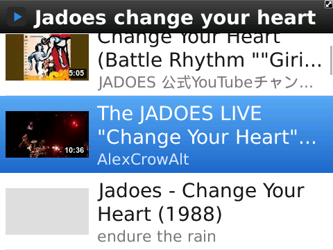 | 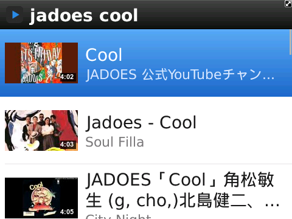 | 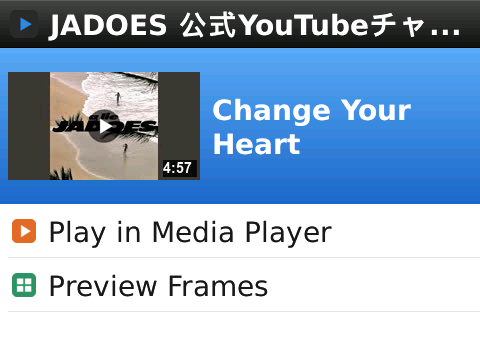 |
| 120×67 thumbnails with lengths burned in by the Mac. The blue selection bar follows the trackpad. Thumbnails fill in as they load. | Titled with the query. Long titles wrap to two lines with an ellipsis. | 192×108 thumbnail with a play overlay. Click it to play in the app. *Play in Media Player* and *Preview Frames* sit below. |

## In-app player

| Preparing | Connecting | Playing |
|---|---|---|
| 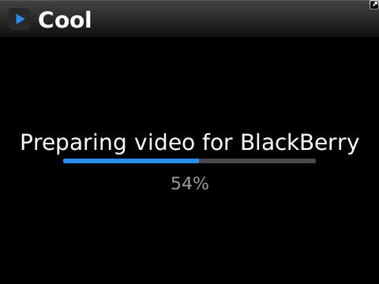 | 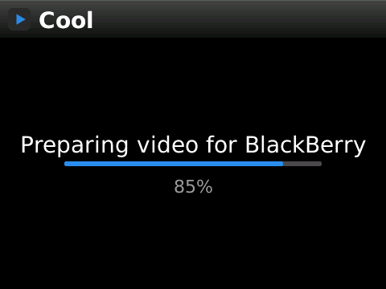 | 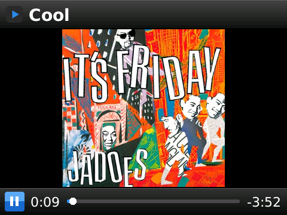 |
| While the Mac converts the video, the progress bar shows how far it has got. | An eight-dot spinner while the player connects. | Video between the title bar and the control bar: play/pause, elapsed time, track with knob, time remaining. Trackpad left/right seeks 10 s. |

*Preview Frames* (a grid of storyboard frames with timestamps) isn't shown: it wasn't captured on the current UI.

---

## How the UI changed

### 1.1: stock LCDUI lists
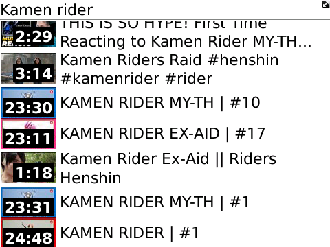

System `List` screens: functional, but plain text with system defaults. Form buttons didn't work on OS 6 (see [CHALLENGES.md §6](CHALLENGES.md#6-form-buttons-dont-fire-on-blackberry-os-6)).

### 1.2.1: hand-drawn OS 6 screens
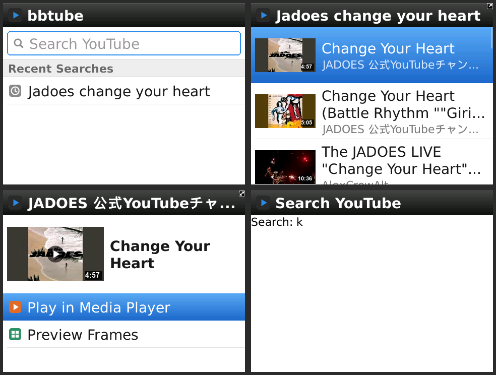

The Canvas redesign. The bottom-right screen is the system `TextBox` used for search at the time, the one screen that still didn't match.

### 1.3.0: search typed on Home
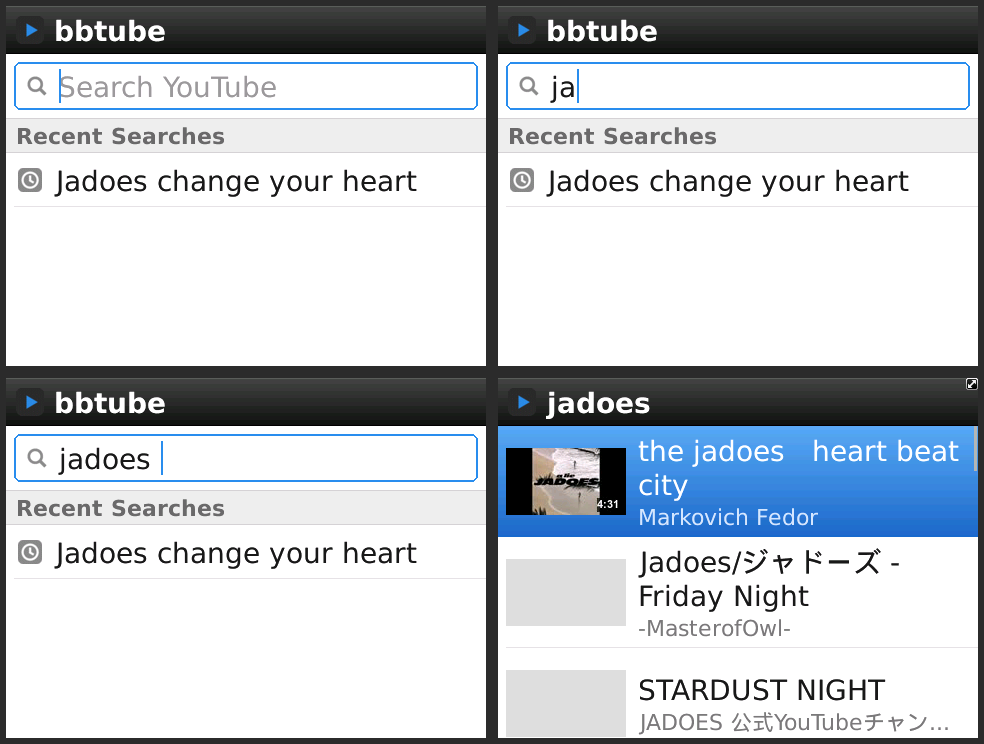

The system search box was replaced by typing straight into the drawn box on the home screen.

### 1.3.1 and later: matching player
The player got the app's title bar and a Media Player‑style control bar (see above). 1.3.2 added trackpad seeking, and 1.3.4 sizes the video before showing it.

---

### Taking your own

```bash
~/barry/bin/bjavaloader screenshot shot.bmp && sips -s format png shot.bmp --out shot.png
```

See [HOWTO.md → Debugging](HOWTO.md#debugging) for recording a whole session.
